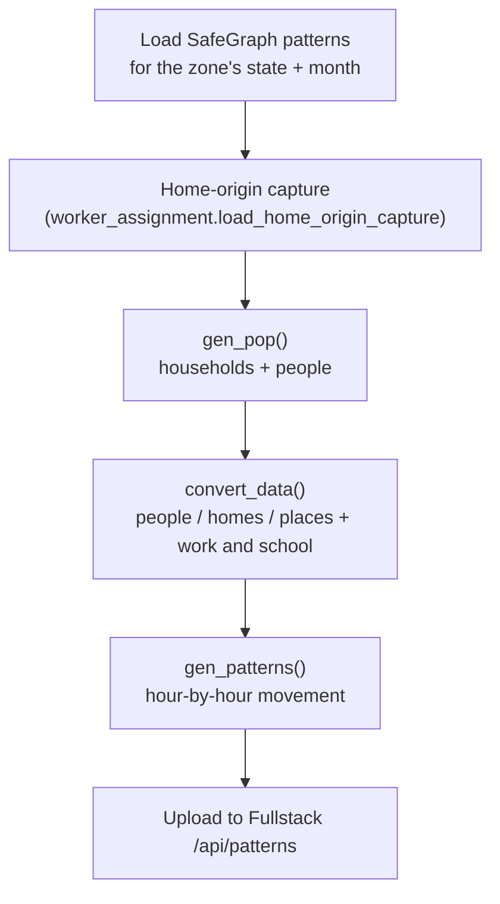

# Deep dive: synthetic population and movement patterns

Once a zone's CBGs are chosen, Algorithms builds the two inputs the simulator
needs:

1. **papdata**: made-up people, households, and places that match the zone's
   Census statistics (`popgen.py`, `papdata_convert.py`, `worker_assignment.py`)
2. **movement patterns**: where every person is during every hour of the zone's
   time window (`patterns.py`, `dwell.py`)

Read the [README](../README.md) and [Clustering](CLUSTERING.md) first. The
output formats are in
[Data formats](https://github.com/Delineo-Disease-Modeling/.github/blob/main/docs/DATA_FORMATS.md).
[`MOVEMENT_MODEL_REDESIGN.md`](MOVEMENT_MODEL_REDESIGN.md) explains *why* the
movement model works the way it does. This page explains *what* it does now.

Everything here describes the code as of October 2026. If you change the
behavior, update this page in the same PR.

## The whole pipeline

`server_app/generation_service.py:gen_and_upload_data` runs in a background
thread after `/finalize-cz`:



Progress is reported to the browser at each stage through
`/generation-progress/<czone_id>`.

## Part 1: the synthetic population

### How many people

`gen_pop` (`popgen.py`) works **county by county**, because the household
statistics it uses are per county:

1. It downloads ACS household statistics for the zone's counties from the
   **Census API** (`census_data.py`): household sizes, family vs. non-family,
   partners, children, and relatives.
2. For each county, it computes the zone's share of that county's population
   and creates that share of the county's households. Those households are
   divided among the zone's CBGs in proportion to each CBG's population.

The result is about the zone's real population, at **full scale**: one
synthetic person per real resident, not a sample.

### Who lives in each household

`generate_household` builds one household at a time:

1. **Composition** (`determine_household_composition`) is drawn from the
   county's ACS distributions: family or not, size, whether there's a partner,
   children, other relatives, or non-relatives. Same-sex couples are included
   at the county's rate.
2. **Age and sex** come from the CBG's own Census table (B01001, in
   `data/cbg_b01.csv`, read by `cbg_demographics.py`), limited to an age range
   that makes sense for the person's role (a householder is 18+, a parent is
   55+, and so on). If the CBG has no data for that range, a role-based normal
   distribution is used instead.
3. **Home location** (`residential.py`): a point inside a residential building
   from OpenStreetMap, or else inside residential land use, or else anywhere in
   the CBG (pulled 15 m in from its edge). Homes only end up with no
   coordinates when the CBG shapes or the `osmnx` library aren't available.
   The simulation still works then, but the maps can't place homes.

### Places

`convert_data` (`papdata_convert.py`) turns every SafeGraph POI inside the zone
into a place, with its name, category, NAICS code, coordinates, building
outline, and:

- **`area`** (m²): from SafeGraph's polygon area, falling back to the median
  for its category, then the overall median. The simulator uses it for
  ventilation.
- **`catchment_fj`**: the share of the POI's real visitors who live inside the
  zone, from `visitor_home_cbgs`. POIs without that field get the median of the
  other POIs. It's never lower than 0.02.

### Work and school

`worker_assignment.py` gives some people a fixed weekday destination:

- **Workers:** adults are employed with probability 65% (ages 18-64) or 10%
  (65+). These can be changed with `DELINEO_WORKER_PROB_18_64` and
  `DELINEO_WORKER_PROB_65_PLUS`. Each worker is assigned **one in-zone POI**,
  chosen at random with weight proportional to floor area, clamped to 50-2,000
  m² so a giant warehouse doesn't absorb everyone.
- **Students:** everyone aged 5-17 is assigned an in-zone school (NAICS 611110,
  or the category "Elementary and Secondary Schools"), also weighted by area. If
  the zone has no school, students go to a synthetic **"Out of Zone School"**
  place.

`work_p_inside`, the share of a CBG's residents whose trips stay inside the
zone, is recorded for each worker. It's for diagnostics only: nobody is sent to
work outside the zone.

## Part 2: movement patterns

`gen_patterns` (`patterns.py`) steps through the zone's time window one hour
at a time. By default that's `length` = 168 hours (one week), starting at the
zone's `start_date`. Each hour, it decides where everyone is and records a
snapshot. A simulation can't run longer than its zone's `length`, and the UI
enforces this.

### Each hour

1. **Visits end.** People whose visit is over return home.
2. **Work and school.** On weekdays (Monday to Friday), every worker is at
   their workplace from **9:00 to 17:00**, and every student is at school from
   **8:00 to 15:00**. Outside those hours they're released, and they can be
   picked for other visits.
3. **Demand pull.** Each POI has a **target occupancy** for this hour:

   ```text
   target[POI] = popularity_by_hour[POI, hour]   (SafeGraph's visitor counts for that hour of day)
               × day_factor[POI, weekday]         (how busy this weekday is compared to the average day)
               × open_gate[POI, weekday, hour]    (≈0 when the place is closed)
               × catchment_fj[POI]                (only the share of visitors who live in the zone)
               × movement_scale                   (SafeGraph sample → full population, per day)
   ```

   POIs below their target are filled with people **chosen at random from
   everyone currently at home**. If the POIs need more people than are at
   home, every POI gets a proportional share.
4. **Visit length.** Each new visitor gets a length of stay:
   - With **fractional dwell** (on by default), it's drawn in minutes from the
     POI's dwell-time distribution, with a random arrival minute. A
     30-minute visit shows up as 30 minutes at the POI, and the rest of that
     hour counts as home (the `minutes` map). Visits under 5 minutes, which are
     mostly people walking past, are dropped by default, and targets are
     reduced to match (`DELINEO_DWELL_DROP_PASS_BY`).
   - Without it, a visit lasts the POI's median dwell time in whole hours,
     plus or minus one.
5. **Snapshot.** Everyone's location is recorded under the key
   `(hour + 1) × 60`.

The random generator is seeded with a fixed value (42), so the same papdata
and data always produce the same patterns.

### Where the numbers come from

- **`popularity_by_hour`** is SafeGraph's count of devices present during each
  hour of the day, totaled over the month. It's effectively an observed
  occupancy curve, which is why it's used directly as the target. The redesign
  doc explains why this replaced the older approach, which made a POI with two
  visits all month look as busy as a Walmart.
- **`day_factor`** is `popularity_by_day` divided by its weekly average.
- **`open_gate`**: on a day that SafeGraph's `open_hours` lists, closed hours
  are a hard 0, so no visits happen then. On days it doesn't list, or when
  there are no opening hours at all, default hours for the POI's NAICS category
  are used, and their closed hours get a small weight (0.001) instead of 0.
- **`movement_scale`** = SafeGraph's sampling factor (read from the data,
  normally about 19.7) ÷ 30 days. **It isn't calibrated against real data,** and
  the code logs a warning saying so. `DELINEO_MOVEMENT_SCALE` overrides it.
- **Dwell distributions** (`dwell.py`): SafeGraph sorts visits into length
  buckets (<5, 5-20, 21-60, 61-240, and >240 minutes). Each POI's bucket mix is
  pulled toward the typical mix for similar businesses (same NAICS group), more
  strongly when the POI has few visitors. This is a standard statistical
  technique called empirical-Bayes shrinkage. POIs whose dwell data is badly
  out of line use the group's mix entirely.

## Assumptions to keep in mind

These are deliberate simplifications. They're worth knowing before you
interpret results:

- **Who goes where is random.** A visitor is picked uniformly from everyone at
  home. Age, distance, household, and habit don't matter, and people don't
  have favorite places. Children are as likely to visit a bar as adults
  (outside school hours).
- **The same weekly routine for everyone.** Every worker works 9-5 on every
  weekday, every student goes to school every weekday, and nobody works
  weekends. There are no holidays or school breaks.
- **Everyone works in the zone.** Real commuters to other towns are modeled as
  working at a POI inside the zone.
- **People from outside the zone are left out.** `catchment_fj` reduces POI
  occupancy to the zone's residents. Out-of-zone visitors never appear as
  people. The simulator can approximate their effect with the external force
  of infection term, which is off by default.
- **Multi-state zones:** `gen_pop` only downloads Census data for the
  **first** state among the zone's CBGs. A zone that crosses a state line gets
  household statistics from one state for every county, and logs a warning.
- **One month of data.** The patterns come from a single month of SafeGraph
  data (the zone's start month), and that month is repeated for the whole
  window.

## Where to start reading the code

1. `server_app/generation_service.py`: `gen_and_upload_data()`, the full
   sequence
2. `popgen.py`: `gen_pop()`, then `SyntheticPopulationGenerator.generate_household()`
3. `papdata_convert.py`: `convert_data()`
4. `worker_assignment.py`: `assign_workers()`, `assign_students()`
5. `patterns.py`: `gen_patterns()`, especially the "demand pull" block
6. `dwell.py`: the dwell model

Tests: `test_popgen_*.py`, `test_worker_assignment.py`,
`test_patterns_demand_pull.py`, `test_patterns_dwell.py`,
`test_patterns_fractional_dwell.py`, `test_census_household_labels.py`.
